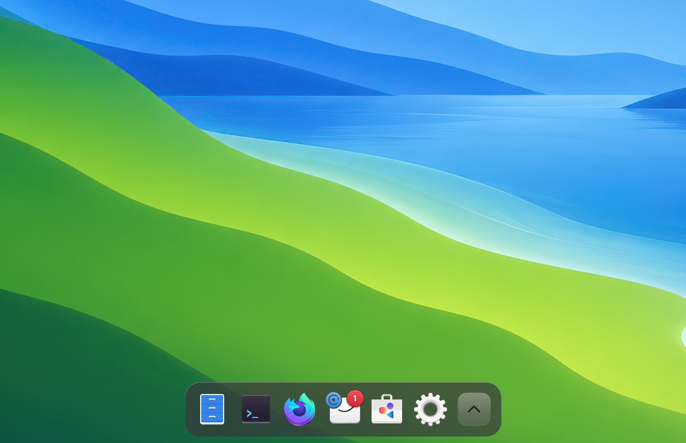
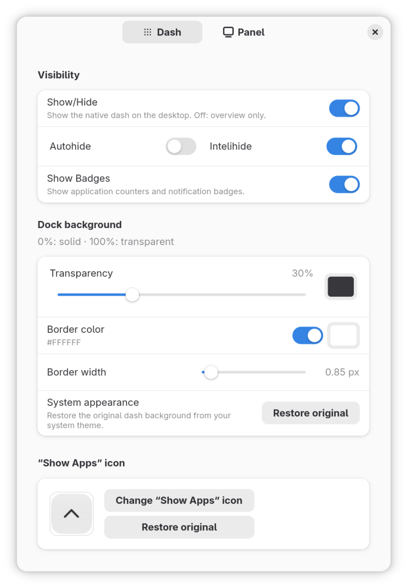
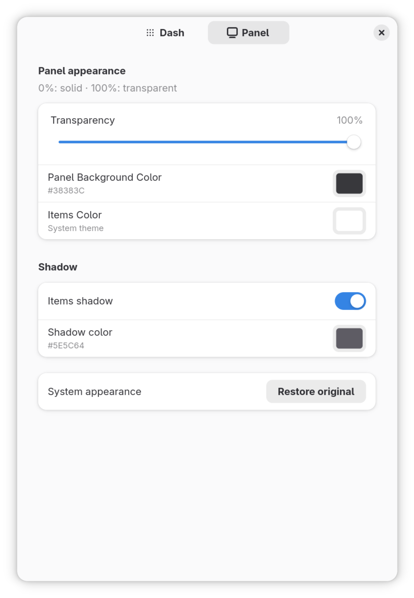

# DashCraft

<p align="center">
  <a href="https://raw.githubusercontent.com/IzsakiRobi/DashCraft/main/Screenshots/dashCraft-Screen-Small.png">
    
  </a>
</p>

<p align="center">
  <a href="https://raw.githubusercontent.com/IzsakiRobi/DashCraft/main/Screenshots/Dash-Settings.png">
    
  </a>
  &nbsp;&nbsp;
  <a href="https://raw.githubusercontent.com/IzsakiRobi/DashCraft/main/Screenshots/Panel-Settings.png">
    
  </a>
</p>

The original GNOME dash on your desktop, with:

- Application unread badges and notification counters
- Smooth icon and dock animations
- Autohide or Intelihide, with a 5 px edge for hover reveal
- Custom Show Apps icon with image preview
- Live dash colors, transparency and fading border highlight
- Panel colors, item shadows and adaptive transparency
- Separate Dash and Panel preferences, accessible by right-clicking Show Apps

GNOME Shell 50–51. Tested on 51.1.

## Install

Run `./install.sh` from the cloned repository, or download the ZIP from [Releases](https://github.com/IzsakiRobi/DashCraft/releases) and install it:

```sh
gnome-extensions install dashcraft@izsakirobi.github.io.shell-extension.zip
```

For manual extraction, use the directory `~/.local/share/gnome-shell/extensions/dashcraft@izsakirobi.github.io/` and compile its settings schema:

```sh
glib-compile-schemas ~/.local/share/gnome-shell/extensions/dashcraft@izsakirobi.github.io/schemas
```

Log out and back in, then enable **DashCraft**.

UUID: `dashcraft@izsakirobi.github.io`
